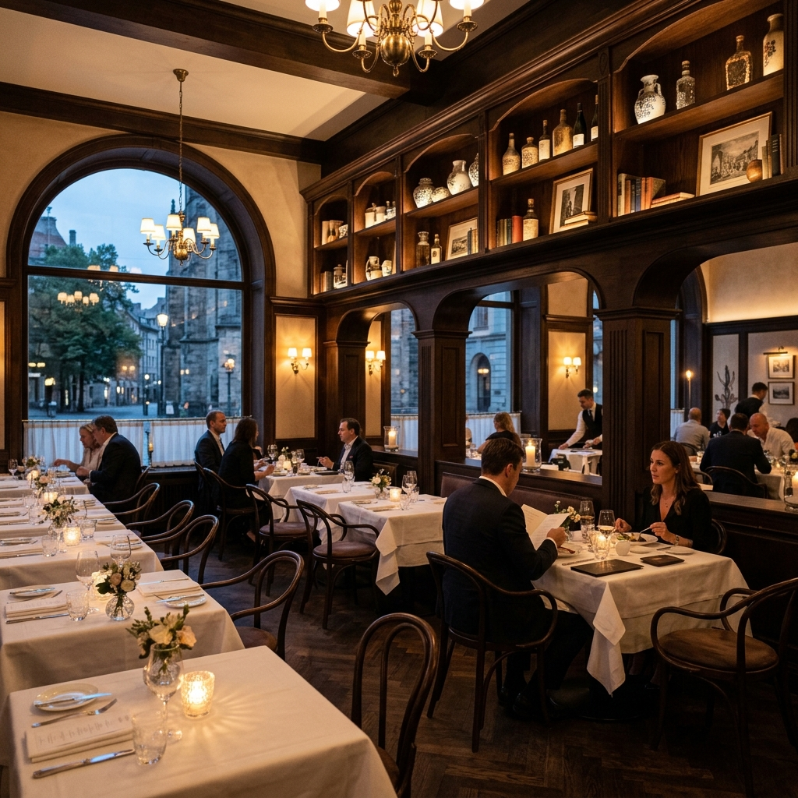

# SmartMenu AR/VR – Modern Interactive Dining Platform

SmartMenu reimagines restaurant dining with photorealistic digital menus, 3D AR table previews, and real-time restaurant management powered by Supabase.



---

## ✨ Features

- **4-Step Restaurant Onboarding**: Complete registration flow capturing owner details, restaurant profile, plan selection, and instant database commitment.
- **Restaurant Dashboard**:
  - **Overview**: Real-time QR table scan analytics, 3D food views, engagement wave chart, and top-viewed dishes.
  - **Menu Management**: Full CRUD operations for dishes, price updates, dietary filters, and instant stock toggle.
  - **Menu Themes**: 5 curated themes (Modern Minimal, Fine Dining, Traditional Indian, Cafe & Bakery, Luxury Dark) with custom brand accents and live mobile phone preview.
  - **Table QR Standees**: Table-specific acrylic QR standee generator ready for printing.
  - **Live Guest Menu & AR Preview**: Interactive guest ordering experience with 3D AR food projection on table.
- **Supabase Cloud Database**:
  - PostgreSQL backend tracking profiles, restaurants, dishes, and QR standees.
  - Row Level Security (RLS) policies and automatic profile generation triggers.

---

## 🚀 Quick Start

Run the application locally with any web server:

### Option 1: Python Built-in Server
```bash
python -m http.server 8000
```
Open your browser at [http://localhost:8000](http://localhost:8000)

### Option 2: Node.js (npx)
```bash
npx serve
```

### Option 3: VS Code
Right-click `index.html` and choose **"Open with Live Server"**.

---

## 📁 Project Structure

```
├── index.html                 # Main web application & restaurant portal
├── style.css                  # Landing page typography & layout styles
├── register-style.css         # 4-step onboarding modal styles
├── dashboard-style.css        # Restaurant dashboard & theme customizer
├── supabase-client.js         # Supabase client, auth & real-time DB engine
├── supabase-schema.sql        # PostgreSQL database schema & triggers
├── script.js                  # Landing page interactions & animations
├── restaurant_interior.png    # High-resolution hero restaurant visual
├── saffron_butter_chicken.png # Dish photo & AR stage preview
├── wild_mushroom_pasta.png    # Dish photo & AR stage preview
├── garden_burrata_bowl.png    # Dish photo & AR stage preview
├── farfalle_pasta_ar.png      # Dish photo & AR stage preview
└── ...
```

---

## 🗄️ Database Setup

The database schema is provided in `supabase-schema.sql`. Run it in your Supabase SQL Editor to initialize all tables:
- `profiles`
- `restaurants`
- `dishes`
- `table_standees`
- `orders`
